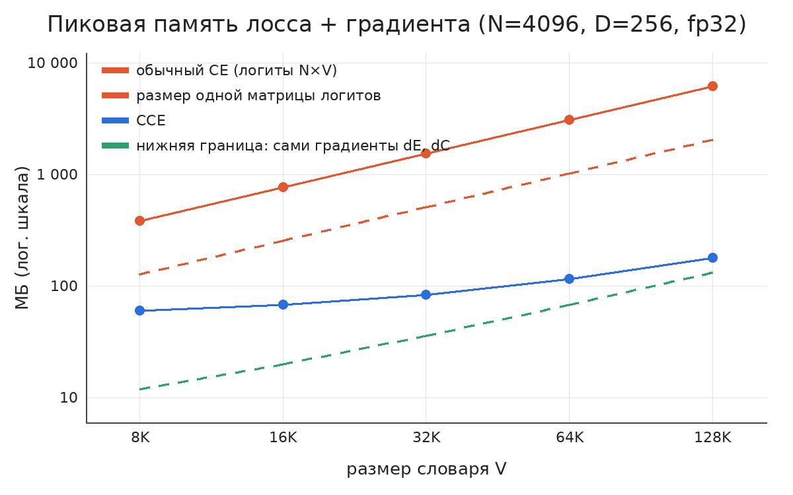
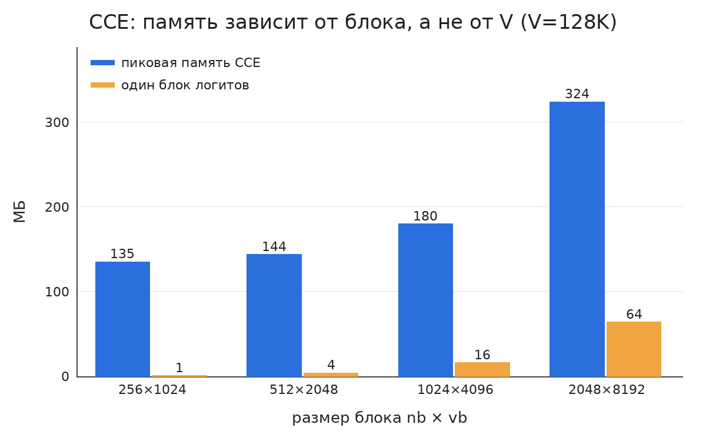
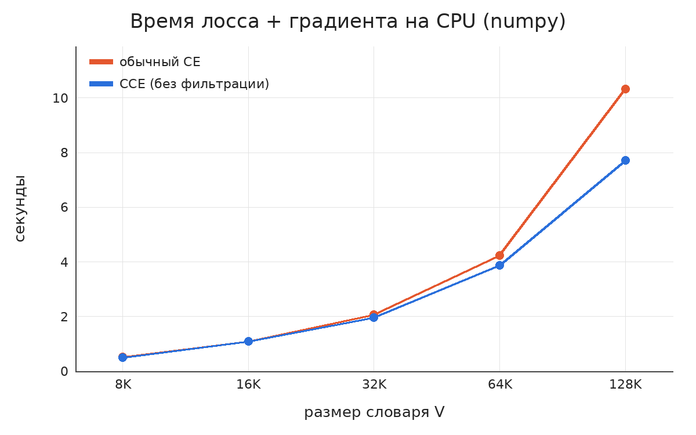
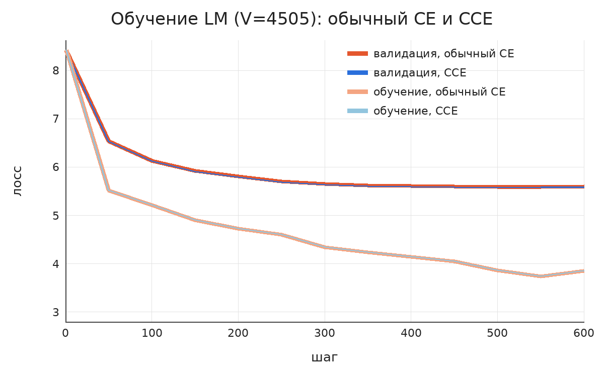
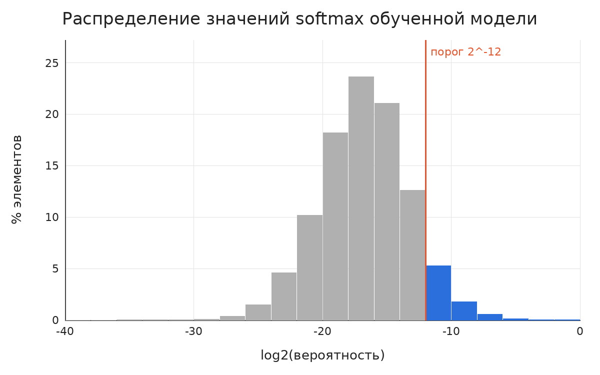
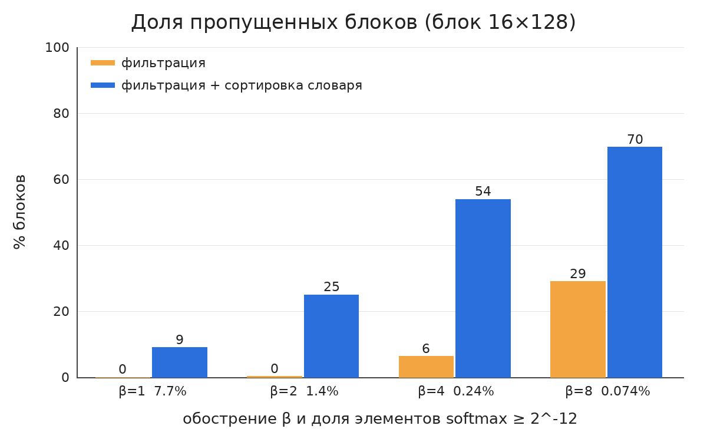

# Отчёт о воспроизведении: Cut Your Losses in Large-Vocabulary Language Models

**Статья:** E. Wijmans, B. Huval, A. Hertzberg, V. Koltun, P. Krähenbühl. *Cut Your Losses in Large-Vocabulary Language Models.* ICLR 2025, [arXiv:2411.09009](https://arxiv.org/abs/2411.09009). Официальный код: [apple/ml-cross-entropy](https://github.com/apple/ml-cross-entropy).

**Курс:** Efficient Models, ИТМО, 2026. Домашнее задание 2.

**Автор воспроизведения:** Карина Денисова.

---

## 1. О чём статья

У современных LLM очень большие словари: у Gemma 2 это 256 000 токенов, у Llama 3 128 000. На последнем шаге модель умножает эмбеддинги токенов `E` (N × D) на матрицу классификатора `C` (V × D) и получает матрицу логитов N × V. Потом из неё считается cross-entropy. При N = 8192 токенов в батче и V = 256 000 одна такая матрица в fp32 занимает 8,4 ГБ. Обычная реализация держит в памяти сразу несколько её копий: сами логиты, softmax и градиент. Поэтому слой лосса съедает больше памяти, чем вся остальная модель, и именно он ограничивает размер батча.

Авторы предлагают **Cut Cross-Entropy (CCE)**, способ посчитать тот же лосс и те же градиенты, ни разу не записывая матрицу логитов в глобальную память. В статье три идеи.

1. **Разложение лосса.** Для токена *i* лосс равен `ℓ_i = logsumexp_j(C_j·E_i) − C_{y_i}·E_i`. Второе слагаемое — скалярное произведение эмбеддинга с одной строкой `C`, и для него вся матрица не нужна (*indexed matmul*). Первое слагаемое — log-sum-exp по словарю. Его можно считать блоками, обновляя бегущий максимум и сумму, как во FlashAttention (*linear-log-sum-exp*). В памяти лежит только один блок логитов, причём на GPU это быстрая SRAM.
2. **Обратный проход** тоже идёт блоками. Логиты блока пересчитываются, из них получается softmax `S = exp(logits − LSE)`, а градиенты накапливаются как `∇E += (S − Y)·C_блок` и `∇C_блок += (S − Y)ᵀ·E`.
3. **Использование разреженности softmax.** У обученной LLM почти все вероятности крошечные. Если в блоке все значения softmax меньше `ε = 2⁻¹²` (порядок точности bf16), его вклад в градиент пренебрежимо мал, и блок пропускается. Это называется *gradient filtering*. Чтобы значимые элементы собирались в меньшее число блоков, словарь переупорядочивают по среднему логиту (*vocabulary sorting*).

**Главный результат статьи:** для Gemma 2 (2B) память на вычисление лосса падает с 24 ГБ до 1 МБ, а память всего классификатора при обучении — с 28 ГБ до 1 ГБ. Скорость при этом сопоставима с `torch.compile`, а кривые обучения совпадают с обычной реализацией.

## 2. Что и как я воспроизводила

В статье реализация написана на Triton, а замеры сделаны на GPU уровня A100/H100. GPU у меня не было, поэтому я воспроизводила **алгоритм и его свойства**, а не скорость конкретного Triton-ядра. Всё написано с нуля на `numpy` и работает на любом CPU, в том числе в бесплатном Colab.

Проверяются четыре утверждения статьи:

| # | Утверждение статьи | Как проверяю |
|---|---|---|
| 1 | CCE вычисляет точно тот же лосс и градиенты | Сравнение с обычной реализацией в fp32 и fp64 |
| 2 | Память CCE не зависит от размера словаря и близка к нижней границе | Пиковая память (`tracemalloc`) при V от 8K до 128K |
| 3 | Обучение с CCE идёт так же, как с обычным лоссом | Обучение маленькой языковой модели двумя способами |
| 4 | Softmax обученной модели разрежен, фильтрация пропускает большую часть работы, а сортировка словаря усиливает эффект | Доля значимых элементов softmax и доля пропущенных блоков |

Кроме того, в разделе 4 я пересчитала цифры статьи для Gemma 2 по формулам и сравнила их с тем, что получилось у меня.

### Реализация (`src/cce.py`)

- `baseline_forward/backward` — обычная реализация: строит полную матрицу логитов N × V, как `F.cross_entropy(E @ C.T, y)` в PyTorch.
- `indexed_dot` — правильный логит `C[y_i]·E_i` без матрицы логитов.
- `linear_lse` — log-sum-exp по блокам `nb × vb` с онлайн-обновлением максимума и суммы. Попутно считает средний логит каждого токена, он нужен для сортировки.
- `cce_backward` — блочный backward с пересчётом логитов, фильтрацией по `ε = 2⁻¹²` и необязательной перестановкой словаря. Блок, в котором лежит правильный токен, не пропускается никогда.

Модель для экспериментов 3 и 4 (`src/lm.py`) — маленькая языковая модель на numpy. Она берёт 4 предыдущих слова, прогоняет их эмбеддинги через линейный слой и tanh, получает `E` размерности D = 64 и считает softmax по словарю. Корпус — «Opticks» Ньютона из Project Gutenberg (121 566 слов, словарь V = 4505). Id слов перемешаны случайно, как в BPE-токенизаторах, иначе словарь был бы уже отсортирован по частоте. Модель обучалась 600 шагов Adam, по 1024 токена в батче, 90% текста на обучение и 10% на валидацию.

Железо: 4 ядра Intel Xeon 2,8 ГГц, 15 ГБ RAM, numpy 2.5 с OpenBLAS, fp32.

## 3. Результаты

### 3.1. Точность: CCE даёт тот же лосс и те же градиенты

N = 1024, D = 64, V = 20 000, блоки 256 × 2048. Ошибка — максимум модуля разности с обычной реализацией.

| Точность | Вариант | Ошибка лосса | Ошибка ∇E | Ошибка ∇C |
|---|---|---|---|---|
| fp32 | CCE | 0 | 1,0·10⁻⁹ | 3,5·10⁻⁹ |
| fp32 | CCE + фильтрация + сортировка | 0 | 1,3·10⁻⁹ | 3,5·10⁻⁹ |
| fp64 | CCE | 0 | 2,2·10⁻¹⁸ | 7,4·10⁻¹⁸ |
| fp64 | CCE + фильтрация + сортировка | 0 | 2,7·10⁻¹⁸ | 7,4·10⁻¹⁸ |

В fp64 расхождение на уровне машинной точности, значит CCE — точная перестановка вычислений, а не приближение. На случайных данных softmax не разрежен, поэтому фильтрация ничего не пропускает и тоже ничего не меняет. **Утверждение 1 подтверждено.**

### 3.2. Память: CCE не зависит от размера словаря

N = 4096 токенов, D = 256, fp32, блоки CCE 1024 × 4096. Пиковая память считается внутри функции, входные `E` и `C` в неё не входят. В неё входят выходные градиенты `∇E` и `∇C`, они и есть нижняя граница, ниже которой не опуститься.



| V | Одна матрица логитов, МБ | Обычный CE, пик, МБ | CCE forward, МБ | CCE forward+backward, МБ | Нижняя граница (∇E + ∇C), МБ | Выигрыш |
|---|---|---|---|---|---|---|
| 8 192 | 128 | 384 | 48 | 60 | 12 | 6,4× |
| 16 384 | 256 | 768 | 48 | 68 | 20 | 11× |
| 32 768 | 512 | 1 536 | 48 | 84 | 36 | 18× |
| 65 536 | 1 024 | 3 072 | 48 | 116 | 68 | 26× |
| 131 072 | 2 048 | **6 144** | **48** | **180** | 132 | **34×** |

Что видно:

- Обычный CE растёт линейно по V и держит в пике **ровно 3 матрицы логитов** (логиты, экспоненты, softmax или градиент).
- Forward CCE занимает 48 МБ при любом V: это три временных буфера одного блока 1024 × 4096. В статье forward CCE для Gemma 2 занимает 1 МБ, потому что Triton-ядро держит блок в SRAM и в глобальной памяти остаётся только вектор LSE размера N.
- Forward+backward CCE = нижняя граница + постоянная добавка на блок (≈ 48 МБ). Вся разница с нижней границей — это блок, а не словарь.
- Выигрыш растёт с V: чем больше словарь, тем полезнее метод. **Утверждение 2 подтверждено.**

Память CCE задаётся размером блока, а не словаря (V = 128K):



При блоке 256 × 1024 пик CCE равен 135 МБ, это почти ровно нижняя граница (132 МБ).

**Время.** На CPU CCE не медленнее обычного CE, а при V = 128K даже быстрее: 7,7 с против 10,3 с. Причина в том, что блок помещается в кэш, а обычный CE гоняет через память гигабайты логитов. В статье на GPU CCE тоже идёт наравне с `torch.compile`. Абсолютные цифры времени на CPU и GPU сравнивать нельзя.



### 3.3. Обучение: кривые совпадают

Одна и та же модель, тот же seed, те же батчи. Разница только в функции лосса: обычный CE или CCE с фильтрацией и сортировкой (блоки 256 × 512).



| | Обычный CE | CCE |
|---|---|---|
| Лосс на обучении, шаг 600 | 3,856 | 3,855 |
| Лосс на валидации, шаг 600 | 5,601 | 5,587 |
| Лучший лосс на валидации | 5,592 | 5,573 |
| Время 600 шагов (CPU) | 44,7 с | 41,2 с |

Кривые лежат друг на друге, максимальное расхождение валидационного лосса за всё обучение — 0,023. Небольшие отличия есть, потому что фильтрация отбрасывает крошечные вклады в градиент, а порядок суммирования другой. За 600 шагов Adam они накапливаются, но на качество не влияют. **Утверждение 3 подтверждено.**

### 3.4. Разреженность softmax, фильтрация и сортировка словаря

Здесь воспроизведение получилось только частично, и это главный вывод работы.

Ключевое условие фильтрации — softmax должен быть разреженным, как у большой обученной LLM. Наша модель маленькая и неуверенная: средняя максимальная вероятность всего 0,22 (перплексия ≈ 290), и **7,7% элементов softmax больше 2⁻¹²**. На 4505 токенов это около 350 значимых элементов в каждой строке.



Поэтому я проверила, как метод ведёт себя, когда softmax становится всё более разреженным. Эмбеддинги `E` умножаются на коэффициент β, это то же самое, что понизить температуру. Структура распределения остаётся той же, что у обученной модели: частые слова получают большие вероятности. Блоки 16 × 128, N = 4096 токенов валидации.

| Модель | β | Доля softmax ≥ 2⁻¹² | Средняя макс. вероятность | Пропущено блоков, фильтрация | Пропущено блоков, фильтрация + сортировка | Отн. ошибка градиента (с сортировкой) |
|---|---|---|---|---|---|---|
| до обучения | 1 | 15,8% | 0,0003 | 0% | 0% | 10⁻⁶ |
| обученная | 1 | 7,7% | 0,22 | 0% | 9,0% | 1,7·10⁻² |
| обученная | 2 | 1,4% | 0,59 | 0,2% | 25,0% | 2,5·10⁻³ |
| обученная | 4 | 0,24% | 0,80 | 6,3% | 53,8% | 5,0·10⁻⁴ |
| обученная | 8 | 0,074% | 0,91 | 29,0% | **69,7%** | 3,7·10⁻⁴ |



Выводы:

- **Фильтрация работает только при сильно разреженном softmax.** Пока значимые элементы есть почти в каждом блоке, пропускать нечего.
- **Сортировка словаря критична, и это подтверждает статью.** Без сортировки значимые токены разбросаны по всему словарю и попадают почти в каждый блок. После сортировки по среднему логиту они собираются в первых блоках, и доля пропущенных блоков растёт в 2–10 раз: при β = 4 с 6% до 54%.
- **Фильтрация — приближение, хоть и аккуратное.** Относительная ошибка градиента при разреженном softmax ~10⁻⁴, это ниже точности bf16 (≈ 4·10⁻³), как и утверждают авторы. При плотном softmax (β = 1) отброшенные блоки в сумме дают ошибку 1,7%. Её вносят редкие токены, у которых много мелких вкладов. Тем не менее в обучении (3.3) с этими настройками кривые совпали.
- **Время на CPU это не показывает.** Пропуск блока экономит два из трёх матричных умножений, но в numpy при блоке 16 × 128 время уходит в основном на Python-цикл, а не на арифметику. Поэтому основной метрикой я сделала долю пропущенных блоков, то есть долю сэкономленных FLOP в backward. Кроме того, при β = 8 время искажают денормализованные числа в `exp`. В статье выигрыш от фильтрации на GPU реальный: по вторичному источнику (см. раздел 5), без фильтрации лосс + градиент CCE считаются примерно в 2,5 раза дольше.

**Утверждение 4 подтверждено качественно**: механизм работает так, как описано, и сортировка нужна. Количественно (насколько разрежен softmax настоящей LLM) проверить его на нашей модели нельзя.

## 4. Сверка с цифрами статьи для Gemma 2 (2B)

Конфигурация из статьи: N = 8192 токенов, V = 256 000, D = 2304, обучение в bf16.

| Величина | Формула | Расчёт | В статье |
|---|---|---|---|
| Одна матрица логитов в fp32 | N·V·4 Б | 7,8 ГиБ | — |
| Обычный CE, 3 матрицы в fp32 (как в наших замерах, п. 3.2) | 3·N·V·4 Б | **23,4 ГиБ** | **24 ГБ** на лосс |
| Forward CCE: только вектор LSE | N·4 Б | 32 КиБ | **1 МБ** |
| Нижняя граница backward: ∇C + ∇E в bf16 | (V·D + N·D)·2 Б | **1,13 ГиБ** | **≈ 1 ГБ** на классификатор |

Наше наблюдение, что обычный CE держит в пике три матрицы логитов, точно объясняет 24 ГБ из статьи. Память CCE на обратном проходе — это память самих градиентов классификатора, меньше которой не бывает. Её уже не уменьшить никаким переписыванием лосса.

## 5. Что не воспроизведено и почему

- **Скорость Triton-ядер на GPU** и сравнение с Liger Kernels, `torch.compile` и Torch Tune: нужен GPU. Цифры из таблицы статьи я взяла из вторичного источника (чужой отчёт о воспроизведении), поэтому привожу их только как ориентир, а не как проверенные.
- **Разреженность softmax настоящих LLM** (Gemma 2, Llama 3 и других): без GPU и без доступа к весам моделей её не измерить. Вместо этого я сделала эксперимент с обострением распределения (п. 3.4).
- **Дообучение больших моделей** (в статье есть кривые для нескольких LLM): заменено обучением маленькой модели (п. 3.3).
- Вычисления в fp32, а не в bf16. Порог `ε = 2⁻¹²` оставлен как в статье.

## 6. Итог

| Утверждение статьи | Результат |
|---|---|
| CCE точно совпадает с обычным CE | ✅ Подтверждено: совпадение до машинной точности |
| Память не зависит от V и равна памяти градиентов + блок | ✅ Подтверждено: 6 144 МБ → 180 МБ при V = 128K (34×) |
| Обучение не страдает | ✅ Подтверждено: кривые совпадают, расхождение ≤ 0,023 |
| Фильтрация и сортировка экономят вычисления | ✅ Механизм подтверждён (до 70% пропущенных блоков), ⚠️ величина эффекта зависит от разреженности softmax, а на маленькой модели она низкая |
| CCE не медленнее обычного CE | ✅ На CPU даже быстрее при больших V. Скорость на GPU не проверялась |

Главный практический вывод: CCE стоит включать всегда, когда словарь большой. Он бесплатно убирает самый «жирный» по памяти слой и позволяет увеличить батч. Ускорение от фильтрации стоит воспринимать как бонус, который проявляется только у уверенных моделей.

## 7. Как запустить

```bash
pip install numpy pillow
python src/experiments.py           # все эксперименты, ~15 минут на 4 ядрах
python src/experiments.py --quick   # уменьшенная версия, ~2 минуты
python src/plots.py                 # графики в figures/
```

Результаты в `results/*.json`, графики в `figures/`.
